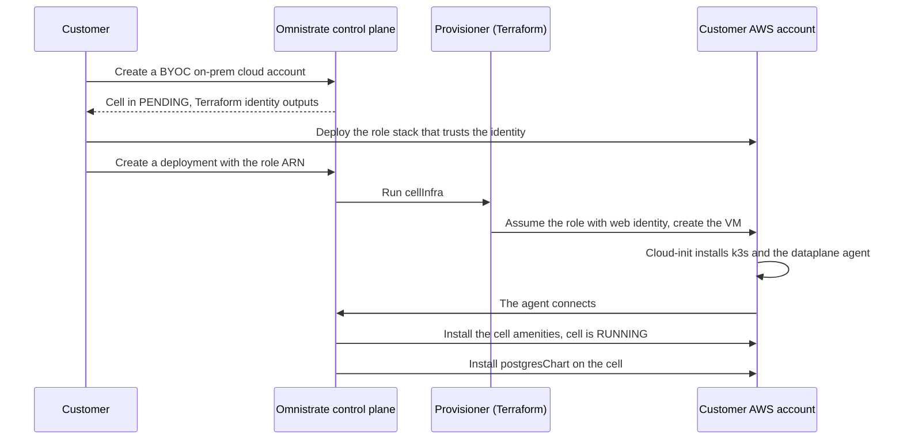

# BYOK with Terraform infrastructure orchestration

This example extends Omnistrate BYOK (Bring Your Own Kubernetes, the `byoc-onprem` deployment model) with a bring-your-own-infrastructure module. In standard BYOK, the customer provides a Kubernetes cluster and installs the Omnistrate dataplane agent on it. In this example, the plan provisions the cluster itself. A Terraform module that the service provider owns runs from the Omnistrate control plane, creates the infrastructure in the customer's cloud account, and installs the agent. The customer grants an IAM role and creates a deployment, and Omnistrate does the rest.

The module in this repository creates a single-node k3s cluster on an EC2 VM. The same pattern applies to any infrastructure that Terraform can create and that ends with a Kubernetes cluster running the agent, such as a larger VM fleet, a managed Kubernetes cluster, or hardware behind a provider API.

## How it works

The plan has two resources:

- `cellInfra` is an internal Terraform resource with `deploymentTarget.account: ControlPlane`. It runs on the Omnistrate provisioner while the customer's cell is still waiting for an agent. It reads the agent install values from `$sys.deploymentCell.customerDeploymentCell` and passes them to the module.
- `postgresChart` is a Helm chart that depends on `cellInfra`. It installs PostgreSQL on the cell after the cell is `RUNNING`.



Terraform does not use long-lived credentials. The provisioner runs the module under a Kubernetes service account that belongs to the customer's BYOC on-prem account instance. The module assumes the customer's role with `sts:AssumeRoleWithWebIdentity`, and the role trusts only that service account.

## Layout

| Path | Contents |
| --- | --- |
| `specs/k3s-cell-aws-public-ecr.yaml` | Plan for a service provider whose agent chart and image come from the public Omnistrate registry. |
| `specs/k3s-cell-aws-private-ecr.yaml` | Plan for a service provider whose agent chart and image come from its private ECR registry, as with the signed BYOC on-prem installer. |
| `terraform/aws-ec2-k3s-cell` | Terraform module that creates the VM, the security group, k3s, and the agent. Both plans use it. |
| `customer-setup/aws/cell-terraform-role.yaml` | CloudFormation template that the customer deploys. It creates the IAM role that the module assumes. |

## Choose a plan

The two plans differ only in the `agent_registry_*` variables. The private plan passes the registry host, user name, password, Docker configuration, and pull secret name from `$sys.deploymentCell.customerDeploymentCell.agent.registry`. Cloud-init then logs Helm in to the registry and creates the image pull secret before it installs the agent. Those system parameters resolve only for a service provider whose agent comes from a private registry. Use the public plan otherwise.

## Build the plan

Replace `<CONTROL_PLANE_AWS_ACCOUNT_ID>` in `deployment.byoaDeployment` of the spec with the AWS account ID of your Omnistrate control plane.

Run `omctl build` from the repository root, because `artifactsLocalPath` is relative to the directory where omctl runs:

```bash
omctl build -f specs/k3s-cell-aws-public-ecr.yaml --product-name "K3s Cell on AWS EC2" --release-as-preferred
```

To build from Git instead, replace `artifactsLocalPath` with a `gitConfiguration` block that points at this repository and set `terraformPath` to `/terraform/aws-ec2-k3s-cell`.

## Customer setup

1. Create a BYOC on-prem cloud account for the customer. The account instance creates a cell in `PENDING` and publishes three outputs:
   - `terraform_identity_oidc_issuer_url`
   - `terraform_identity_subject`, which has the form `system:serviceaccount:dataplane-agent:tf-<account instance ID>`
   - `terraform_identity_audience`
2. Deploy the role stack in the customer's AWS account with those outputs:

   ```bash
   aws cloudformation deploy \
     --stack-name omnistrate-k3s-cell-terraform \
     --template-file customer-setup/aws/cell-terraform-role.yaml \
     --capabilities CAPABILITY_NAMED_IAM \
     --parameter-overrides \
       OIDCIssuerURL=<terraform_identity_oidc_issuer_url> \
       Subject=<terraform_identity_subject> \
       Audience=<terraform_identity_audience>
   ```

3. Create a deployment of the plan on that cloud account. Set `customerRoleArn` to the `CellTerraformRoleArn` output of the stack.

An AWS account can hold only one IAM OIDC provider per issuer. When a provider for the issuer already exists, pass its ARN as `ExistingOIDCProviderArn` and add the audience to it first. A provider that another setup created can list only `sts.amazonaws.com`, and STS then rejects the service account token with `InvalidIdentityToken`.

```bash
aws iam add-client-id-to-open-id-connect-provider \
  --open-id-connect-provider-arn <provider ARN> \
  --client-id <terraform_identity_audience>
```

The role can create EC2 instances and security groups, and it can change or delete only the resources tagged `omnistrate-deployment=instance-*`. Each account instance has its own subject, so a new account instance needs a new stack or an updated trust policy.

## Deployment parameters

| Parameter | Required | Description |
| --- | --- | --- |
| `pgPassword` | Yes | PostgreSQL admin password. |
| `pgDatabase` | Yes | Default database name. The default is `appdb`. |
| `customerRoleArn` | Yes | `CellTerraformRoleArn` from the role stack. |
| `awsRegion` | Yes | Region of the VM. |
| `subnetId` | No | Subnet of the VM. The subnet needs outbound internet access. An empty value selects a default subnet of the default VPC. |
| `instanceType` | No | EC2 instance type. The default is `t3.2xlarge`. |
| `rootVolumeSizeGiB` | No | Root volume size in GiB. The default is `80`. |
| `sshAuthorizedKeys` | No | Comma-separated SSH public keys for the `ubuntu` user, which has a kubeconfig for the cluster. |
| `ingressCidrs` | No | Comma-separated CIDRs that may reach ports 22, 80, 443, and 30000 to 32767. An empty value creates no inbound rules. The agent needs only outbound access. |

## Bring your own infrastructure module

To provision different infrastructure, replace the module and keep its contract with the plan. The module receives these values from `variablesValuesFileOverride`:

| Variable | Source |
| --- | --- |
| `deployment_id` | `$sys.id` |
| `cell_name` | `$sys.deploymentCell.customerDeploymentCell.clusterName` |
| `agent_chart_repository`, `agent_chart_version` | `$sys.deploymentCell.customerDeploymentCell.agent.chart.*` |
| `agent_namespace`, `agent_release_name` | `$sys.deploymentCell.customerDeploymentCell.agent.*` |
| `agent_helm_values_base64` | `$sys.deploymentCell.customerDeploymentCell.agent.helmValuesBase64` |
| `agent_registry_*` | `$sys.deploymentCell.customerDeploymentCell.agent.registry.*`, private registry plan only |

The module must create a Kubernetes cluster with outbound access to the Omnistrate control plane and install the agent chart with the decoded Helm values. The values contain the agent's client key, so treat them as a secret. The cell moves to `RUNNING` when the agent connects. Resources that depend on `cellInfra` wait for that, then deploy onto the new cluster.

The module runs once per deployment. Later changes to the agent values must not replace the cluster, so the EC2 module ignores changes to its user data. Agent upgrades go through the control plane after the agent connects.

## Delete

Deleting a deployment uninstalls PostgreSQL first. Then `cellInfra` runs `terraform destroy` and removes the VM. The cleanup steps that reach the cell through the agent are skipped once the first of them fails, and the delete completes. The cell record stays unchanged. To start over, delete the BYOC on-prem account instance, create a new one, and update the role trust to the new subject.

## Verification

The private registry plan, with this module and role template, ran end to end against an Omnistrate control plane on 2026-11-09. The run created the cloud account, the role stack, and the deployment, connected to PostgreSQL, and deleted the deployment and the cloud account.

The public registry plan has not run end to end. It renders the same cloud-init without the registry login.

## License

Apache License 2.0. See [LICENSE](LICENSE).
